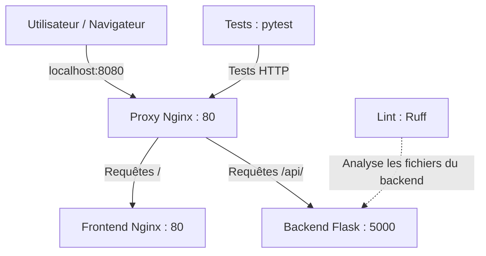

# Architecture du projet

Le projet est composé de cinq services Docker :

- `front` : affiche l'interface du catalogue de cookies
- `back` : fournit les données des cookies via une API Flask
- `proxy` : reçoit les requêtes HTTP et les redirige vers le frontend ou le backend
- `lint` : vérifie le code Python avec Ruff
- `tests` : teste le fonctionnement de l'API avec pytest

Les trois premiers services permettent de faire fonctionner le site. Les deux autres servent à vérifier le code et l'API.

## Construction des images

Chaque service possède son propre `Dockerfile`.

### Frontend

Le frontend utilise l'image `nginx:alpine`.

J'ai choisi Nginx car le site est statique et contient uniquement du HTML, du CSS et du JavaScript. La version Alpine permet d'utiliser une image plus légère.

Le `Dockerfile` copie les fichiers du site dans `/usr/share/nginx/html`, le dossier utilisé par Nginx pour servir les pages web.

Le frontend utilise le port `80` et conserve la commande de démarrage de l'image officielle Nginx.

### Backend

Le backend utilise l'image `python:3.12-alpine`.

J'ai choisi Python avec Flask car le projet a seulement besoin d'une petite API pour renvoyer les données du catalogue.

Le fichier `requirements.txt` contient les dépendances Python, installées avec `pip` pendant la construction de l'image.

L'instruction `WORKDIR /app` définit le dossier de travail. Le `Dockerfile` y copie ensuite `app.py` et le dossier `data` contenant `cookies.json`.

Le backend utilise le port `5000`.

La commande `CMD ["python", "app.py"]` lance Flask au démarrage du conteneur.

### Proxy

Le proxy utilise l'image `nginx:alpine`.

Il sert de point d'entrée unique pour l'application et redirige les requêtes vers le bon service.

Le `Dockerfile` copie le fichier `nginx.conf` dans `/etc/nginx/nginx.conf` pour utiliser la configuration du projet.

Le proxy utilise le port `80` dans son conteneur et conserve la commande de démarrage de Nginx.

## Docker Compose

Docker Compose permet de lancer et d'orchestrer les services du projet.

Le service `proxy` dépend de `front` et `back` grâce à `depends_on`. Cette option définit l'ordre de démarrage, mais ne garantit pas que les services sont déjà prêts.

Les trois services principaux communiquent sur le réseau Docker `cookie-network`.

Seul le proxy expose un port vers la machine hôte. Le frontend et le backend restent accessibles uniquement depuis le réseau Docker.

### Variables et arguments

Le fichier `.env` permet de définir les paramètres utilisés dans `docker-compose.yml`.

Les variables sont :

- `PROXY_PORT` : port utilisé pour accéder à l'application
- `FRONT_MEMORY` et `FRONT_CPU` : limites du frontend
- `BACK_MEMORY` et `BACK_CPU` : limites du backend
- `PROXY_MEMORY` et `PROXY_CPU` : limites du proxy

Docker Compose récupère ces valeurs avec la syntaxe `${VARIABLE}`.

La configuration `${PROXY_PORT}:80` permet de relier le port de la machine au port `80` du proxy.

### Limites des ressources

| Service | Mémoire | CPU |
|---|---:|---:|
| Front | 128 MiB | 0.25 |
| Back | 256 MiB | 0.50 |
| Proxy | 128 MiB | 0.25 |

Le backend possède plus de ressources car Python et Flask sont plus lourds que Nginx.

Ces limites permettent de contrôler les ressources utilisées par les conteneurs.

La consommation a été vérifiée avec Docker Stats. Les résultats sont disponibles dans [`benchmark.md`](benchmark.md).

## Conteneurs de vérification

Deux conteneurs supplémentaires ont été ajoutés pour le lint et les tests.

Ils utilisent le profil `tools` dans Docker Compose pour ne pas démarrer automatiquement avec le site.

### Lint

Le conteneur `lint` utilise `python:3.12-alpine` avec Ruff, installé avec `pip`.

J'ai choisi Ruff car il permet de détecter certaines erreurs dans le code Python sans lancer l'application.

Le dossier `back` est monté dans `/app` en lecture seule avec `./back:/app:ro`.

L'`ENTRYPOINT` lance `ruff check --no-cache` et le `CMD ["."]` indique le dossier à analyser.

L'option `--no-cache` évite que Ruff essaie de créer des fichiers dans le dossier en lecture seule.

Commande utilisée :

```bash
docker compose run --rm lint
```

Résultat obtenu : `All checks passed!`.

### Tests

Le conteneur `tests` utilise `python:3.12-alpine` avec pytest et Requests, installés avec `pip`.

J'ai choisi pytest pour exécuter les tests automatiques et Requests pour envoyer des requêtes HTTP à l'API.

Le `Dockerfile` copie `test_api.py` dans `/app`.

Le fichier contient deux tests :

- Vérifier que l'API répond avec le code HTTP `200`.
- Vérifier que l'API renvoie une réponse JSON.

Le `CMD ["pytest", "-v"]` lance les tests au démarrage du conteneur.

Dans Docker Compose, `tests` dépend du proxy et utilise le réseau `cookie-network` pour accéder à l'API.

Commande utilisée :

```bash
docker compose run --rm tests
```

Résultat obtenu : `2 passed`.

L'option `--rm` supprime les conteneurs temporaires après leur exécution.

## Gestion du SIGTERM

Un conteneur reste actif tant que son processus principal fonctionne.

Pour le backend, le processus principal est `python app.py`.

Lors d'un `docker stop` ou d'un `docker compose down`, Docker envoie un signal `SIGTERM` pour demander l'arrêt du processus.

Le backend intercepte ce signal dans `app.py`, affiche un message puis termine le programme avec `sys.exit(0)`.

Si le processus ne s'arrête pas dans le délai prévu, Docker peut forcer son arrêt.

## Schéma des communications



La liaison entre `lint` et `back` représente l'accès aux fichiers du backend et non une communication réseau.
